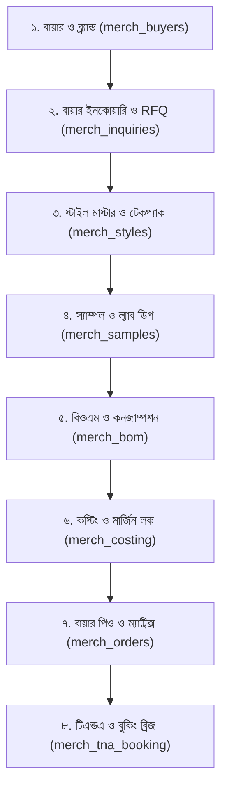

# ডোমেন ০১: মার্চেন্ডাইজিং, কস্টিং ও অর্ডার প্রসেসিং - পূর্ণাঙ্গ ফিচার ম্যাট্রিক্স
## Domain 01: Merchandising, Costing & Order Processing (O2S Architecture)

> **ডকুমেন্ট রেফারেন্স**: `SPEC-D1-MERCH-8M18S`  
> **প্রণেতা**: 👩‍💼 নাসরিন সুলতানা *(Lead Technical Writer)* ও 👨‍💼 তানভীর আহমেদ *(Chief Architect)*  
> **আর্কিটেকচারাল স্ট্যাক**: Java 21, Spring Boot 3.3+, PostgreSQL 17 (JSONB/BigDecimal), React 19, Tailwind CSS v4  
> **কোর নীতিমালা**: রুল ০৭ (<৩০০ লাইন), রুল ১২ (স্কিমা গেট), রুল ২৪ (অটো-কোড), রুল ২৮ (একক-শব্দের বাটন), রুল ২৯ (মিনিমাল মাইক্রোকপি)

---

### 🗺️ এন্ড-টু-এন্ড ডোমেন ০১ প্রসেস হায়ারার্কি (Data Flow)

---

### 📋 ৮টি কোর মডিউল ও ১৮টি সাব-মডিউল বিস্তারিত স্পেসিফিকেশন

#### 🏢 মডিউল ১: বায়ার ও ব্র্যান্ড ম্যানেজমেন্ট (`merch_buyers`)
- **১.১ Buyer Corporate Profile (`buyer_profiles`)**:
  - *কোড জেনারেশন*: `BYR-xxxx` (রুল ২৪ অনুযায়ী ডাইনামিক সিকোয়েন্স)।
  - *ফিচার*: গ্লোবাল বায়ার প্রোফাইল, কান্ট্রি, ইনভয়েস কারেন্সি (USD/EUR/BDT), ইনকোটার্মস (FOB, CIF, CFR), পেমেন্ট টার্মস (L/C at sight, TT, CAD), পোর্ট অব লোডিং/ডিসচার্জ, অডিট সার্টিফিকেশন (GOTS, BCI, SEDEX, OEKO-TEX), লিয়াজোঁ কন্টাক্ট পারসন।
- **১.২ Brand & Division Portfolio (`buyer_brands`)**:
  - *ফিচার*: মূল বায়ারের অধীন সাব-ব্র্যান্ড ম্যানেজমেন্ট (যেমন: Inditex ➔ Zara Man, Zara Kids, Pull&Bear), ব্র্যান্ড কোড, ডেডিকেটেড মার্চেন্ডাইজার অ্যাসাইনমেন্ট।

#### 📩 মডিউল ২: বায়ার ইনকোয়ারি ও সম্ভাব্যতা (`merch_inquiries`)
- **২.১ Inquiry Ticket & Feasibility (`inquiry_tickets`)**:
  - *কোড জেনারেশন*: `INQ-xxxx`।
  - *ফিচার*: সিজন (SS27, FW26), প্রোডাক্ট ব্রিফ, টার্গেট ডেলিভারি ডেট, প্রজেক্টেড ভলিউম, বায়ারের টার্গেট প্রাইস, টেকনিক্যাল সম্ভাব্যতা স্কোর (Machine Capacity & Skill fit)।
- **২.২ Quick Quotation & Lead Tracker (`inquiry_quotations`)**:
  - *ফিচার*: প্রাথমিক দ্রুত কোটেশন (Quick Pre-Cost), লিড কনভার্সন ট্র্যাকার (Lead, Quoted, Negotiating, Won, Lost), ড্রপ হওয়ার কারণ বিশ্লেষণ (Price High, Capacity Shortage)।

#### 👔 মডিউল ৩: স্টাইল মাস্টার ও টেকপ্যাক হাব (`merch_styles`)
- **৩.১ Style Master Directory (`style_master`)**:
  - *কোড জেনারেশন*: `STY-xxxx`।
  - *ফিচার*: বায়ার স্টাইল নম্বর, স্টাইল নেম, ডিপার্টমেন্ট (Men/Women/Boys/Girls), প্রোডাক্ট ক্যাটাগরি (5-Pocket Denim, Chino, Cargo, Jacket, Shirt), ডেনিম ওয়াশ টাইপ (Raw, Enzyme, Acid, Bleach, Tinted), মার্চেন্ডাইজার ও টেকনিক্যাল টিম ওনারশিপ।
- **৩.২ Tech Pack Multi-Revision & POM Grading (`tech_pack_revisions`)**:
  - *ফিচার*: টেকপ্যাক ফাইল ভার্সন কন্ট্রোল (Rev 1, Rev 2...), পয়েন্ট অব মেজারমেন্ট (POM) চার্ট, সাইজ স্পেক্স গ্রেডিং শিট (Tolerances +/- in cm/inch), মেজারমেন্ট হিস্ট্রি ও ডিফারেন্স ট্র্যাকার।

#### 🧪 মডিউল ৪: স্যাম্পল লাইফসাইকেল ও ল্যাব ডিপ অনুমোদন (`merch_samples`)
- **৪.১ Sample Stage Lifecycle (`sample_tracker`)**:
  - *কোড জেনারেশন*: `SMP-xxxx`।
  - *ফিচার*: স্যাম্পল স্টেজ ট্র্যাকিং (Proto ➔ Fit ➔ SMS ➔ Size-Set ➔ PP Sample ➔ Gold Seal / Red Seal), স্যাম্পল ডেলিভারি কুরিয়ার ট্র্যাকিং নম্বর, বায়ারের রিভিশন ও কমেন্টস লগ, স্যাম্পল সাইন-অফ গেট।
- **৪.২ Lab Dip & Strike-Off Engine (`lab_dip_approvals`)**:
  - *কোড জেনারেশন*: `LBD-xxxx`।
  - *ফিচার*: প্যানটোন কোড (Pantone TCX/TPX), ল্যাব ডিপ অপশন ট্র্যাকিং (Option A, B, C, D), স্পেক্ট্রোফটোমিটার ডেল্টা-ই ($\Delta E$) স্কোর, লাইট সোর্স ভেরিফিকেশন (D65, TL84, CWF), বায়ার শেড অনুমোদন স্ট্যাটাস (Approved, Rejected, Resubmit), প্রিন্ট স্ট্রাইক-অফ ও হ্যান্ডলুম ট্র্যাকার।

#### 🧵 মডিউল ৫: বিওএম ও কনজাম্পশন ইঞ্জিন (`merch_bom`)
- **৫.১ Fabric Consumption Engine (`fabric_consumption`)**:
  - *ফিচার*: ডেনিম ও ওভেন ফেব্রিক ফর্মুলা ($\text{Yds/Dzn}$), নিট ফেব্রিক ($\text{Kg/Dzn}$), ওয়াশিং শ্রিংকেজ পার্সেন্টেজ সমন্বয় ($\text{Warp \% / Weft \%}$), মার্কার এফিসিয়েন্সি %, স্প্রেডিং ও কাটিং অপচয় বাফার (Wastage %) সহ শতভাগ নির্ভুল `BigDecimal` ক্যালকুলেশন।
- **৫.২ Trims & Accessories BOM (`trims_bom`)**:
  - *ফিচার*: বোতাম, রিভেট, মেটাল জিপার, সেলাই সুতা (Thread Tex 40/60), লেদার প্যাচ, লেবেল, পলি ও কার্টনের আইটেম স্পেসিফিকেশন ও একক রূপান্তর (Gross, Cone, Dozen, Piece)।

#### 💰 মডিউল ৬: প্রি-অর্ডার ও পোস্ট-অর্ডার কস্টিং (`merch_costing`)
- **৬.১ Pre-Order Costing Builder (`costing_sheets`)**:
  - *কোড জেনারেশন*: `CST-xxxx`।
  - *ফিচার*: ফেব্রিক কস্ট + ট্রিমস কস্ট + সিএম (কাটিং ও মেকিং মজুরি) + লন্ড্রি ওয়াশ চার্জ + প্রিন্ট/এমব্রয়ডারি + টেস্ট/ইন্সপেকশন ফি + কমার্শিয়াল ও ওভারহেড + প্রফিট মার্জিন = টোটাল FOB রেট ক্যালকুলেটর।
- **৬.২ Costing Approval & Margin Lock (`costing_approvals`)**:
  - *ফিচার*: মাল্টি-লেভেল কস্টিং ভার্সনিং (Draft ➔ Review ➔ Approved), ম্যানেজমেন্ট মার্জিন লক, বাজেটেড বনাম প্রকৃত খরচের ভ্যারিয়েন্স ট্র্যাকিং, বায়ার অফিশিয়াল কোটেশন শিট এক্সপোর্ট।

#### 📦 মডিউল ৭: বায়ার পারচেজ অর্ডার ও সাইজ-কালার গ্রিড (`merch_orders`)
- **৭.১ Order Placement & Split Shipment (`buyer_orders`)**:
  - *কোড জেনারেশন*: `ORD-xxxx`।
  - *ফিচার*: কনফার্মড বায়ার পিও নম্বর, ইনকোয়ারি/কস্টিং থেকে ১-ক্লিকে পিও কনভার্সন, মাল্টিপল ডেলিভারি শিডিউল ও স্প্লিট শিপমেন্ট (Destination Ports: Hamburg, Rotterdam, NY; Shipment Mode: Sea/Air), মাস্টার এল/সি ও সেলস কন্ট্রাক্ট ট্যাগিং।
- **৭.২ 2D Size-Color-Inseam Matrix (`order_matrix_items`)**:
  - *ফিচার*: হাই-স্পিড এক্সেল-স্টাইল ২ডি ম্যাট্রিক্স গ্রিড (কালার $\times$ সাইজ $\times$ ইনসিম), অটো-সামেশন, কালারভিত্তিক ইউনিট প্রাইস, টোটাল পিও কোয়ান্টিটি ও টোটাল অর্ডার ভ্যালু ক্যালকুলেশন, পিও অ্যামেন্ডমেন্ট/রিভিশন অডিট ট্রেইল।

#### ⏱️ মডিউল ৮: টিএন্ডএ ক্যালেন্ডার ও ম্যাটেরিয়াল বুকিং ব্রিজ (`merch_tna_booking`)
- **৮.১ Time & Action (T&A) Calendar (`tna_calendars`)**:
  - *কোড জেনারেশন*: `TNA-xxxx`।
  - *ফিচার*: প্রতিটি পিও-র জন্য ক্রিটিক্যাল পাথ অটো-জেনারেটর (ল্যাব ডিপ, ফেব্রিক ইন-হাউজ, পিপি মিটিং, কাটিং স্টার্ট, ওয়াশ, ফাইনাল ইন্সপেকশন), পরিকল্পিত বনাম প্রকৃত তারিখ, স্বয়ংক্রিয় ডিলে অ্যালার্ট ও বটলনেক নোটিফিকেশন।
- **৮.২ Material Procurement Booking (`material_bookings`)**:
  - *কোড জেনারেশন*: `BKG-xxxx`।
  - *ফিচার*: কনফার্মড পিও ও বিওএম থেকে স্বয়ংক্রিয় **Fabric Booking Requisition** ও **Trims Booking Sheet** তৈরি; ডোমেন ০২ (ইনভেন্টরি ও প্রকিউরমেন্ট)-এর সাথে ১-ক্লিকে ডেটা আদান-প্রদান।

---

### 🔐 গ্র্যানুলার রোল ও পারমিশন ম্যাট্রিক্স (RBAC Mapping)

| মডিউল কোড | মডিউল নাম | ভিউ পারমিশন | ক্রিয়েট/এডিট | স্পেশাল অপারেশনস |
| :--- | :--- | :--- | :--- | :--- |
| `merch_buyers` | বায়ার ও ব্র্যান্ড | `BUYER:VIEW` | `BUYER:CREATE`, `BUYER:EDIT` | `BUYER:DELETE` |
| `merch_inquiries` | ইনকোয়ারি ও RFQ | `INQUIRY:VIEW` | `INQUIRY:CREATE`, `INQUIRY:EDIT` | `INQUIRY:CONVERT` |
| `merch_styles` | স্টাইল ও টেকপ্যাক | `STYLE:VIEW` | `STYLE:CREATE`, `STYLE:EDIT` | `TECHPACK:UPLOAD` |
| `merch_samples` | স্যাম্পল ও ল্যাব ডিপ | `SAMPLE:VIEW` | `SAMPLE:CREATE`, `SAMPLE:EDIT` | `LABDIP:APPROVE` |
| `merch_bom` | বিওএম ও কনজাম্পশন | `BOM:VIEW` | `BOM:CREATE`, `BOM:EDIT` | `BOM:LOCK` |
| `merch_costing` | কস্টিং ও কোটেশন | `COSTING:VIEW` | `COSTING:CREATE`, `COSTING:EDIT`| `COSTING:APPROVE` |
| `merch_orders` | বায়ার পিও ও ম্যাট্রিক্স | `ORDER:VIEW` | `ORDER:CREATE`, `ORDER:EDIT` | `ORDER:AMEND` |
| `merch_tna_booking`| টিএন্ডএ ও বুকিং | `TNA:VIEW` | `TNA:CREATE`, `TNA:EDIT` | `BOOKING:ISSUE` |

---

### 🌐 ইউআই রুট ও মেনু হায়ারার্কি (Kebab-Case URLs)
- `/app/merchandising/buyers` ➔ Buyer & Brand Portfolio
- `/app/merchandising/inquiries` ➔ Buyer Inquiry & RFQ Tickets
- `/app/merchandising/styles` ➔ Style Master & Tech-Packs
- `/app/merchandising/samples` ➔ Sample Development & Lab Dips
- `/app/merchandising/bom` ➔ BOM & Consumption Calculator
- `/app/merchandising/costing` ➔ Pre-Order Costing & Margin Lock
- `/app/merchandising/orders` ➔ Confirmed Buyer POs & Matrix Grid
- `/app/merchandising/tna` ➔ Time & Action (T&A) Calendar & Bookings

---

> 🔒 **ডকুমেন্টেশন সাইন-অফ**:  
> প্রস্তুতকারক: 👩‍💼 নাসরিন সুলতানা (Technical Writer) ও 👨‍💼 তানভীর আহমেদ (Chief Solutions Architect)  
> পর্যালোচক: 👨‍💻 আরিফুল ইসলাম (Tech Lead) ও 👩‍💻 সাদিয়া জাহান (Frontend Lead)  
> কোয়ালিটি গেট: 👩‍🔬 ফারহানা চৌধুরী (Lead QA)  
> অবকাঠামো ও ডেপ্লয়মেন্ট: 👨‍💻 মাহমুদুল হাসান (DevOps Lead)
